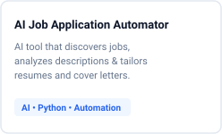
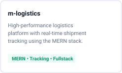
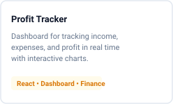

  <picture>
    <source media="(prefers-color-scheme: dark)" srcset="./assets/wordmark-dark.svg" />
    
  </picture>

  <picture>
    <source media="(prefers-color-scheme: dark)" srcset="./assets/bio-dark.svg" />
    
  </picture>

<blockquote align="center">
  <i>"I build fast, responsive web applications and support the systems that keep them running."</i>
</blockquote>

 

  <picture>
    <source media="(prefers-color-scheme: dark)" srcset="./assets/section-projects-dark.svg" />
    
  </picture>

  <a href="https://github.com/MrMikeAde/ai-job-application-automator">
    <picture>
      <source media="(prefers-color-scheme: dark)" srcset="./assets/card-ai-automator-dark.svg" />
      
    </picture>
  </a>
  <a href="https://github.com/MrMikeAde/m-logistics">
    <picture>
      <source media="(prefers-color-scheme: dark)" srcset="./assets/card-mlogistics-dark.svg" />
      
    </picture>
  </a>
  <a href="https://github.com/MrMikeAde/Profit-tracker">
    <picture>
      <source media="(prefers-color-scheme: dark)" srcset="./assets/card-profit-tracker-dark.svg" />
      
    </picture>
  </a>

 

  <picture>
    <source media="(prefers-color-scheme: dark)" srcset="./assets/section-tech-dark.svg" />
    
  </picture>

  

 

  

 

  <picture>
    <source media="(prefers-color-scheme: dark)" srcset="./assets/section-connect-dark.svg" />
    
  </picture>

  
  
  
  
  

